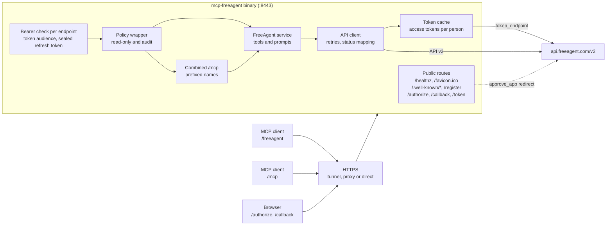
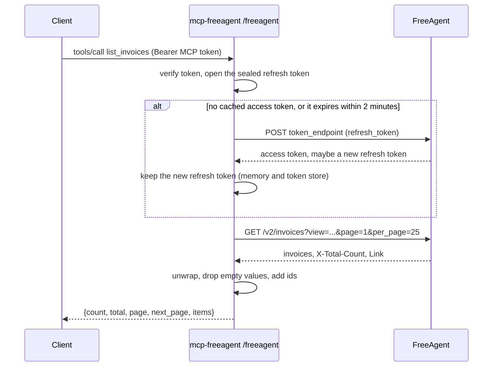

# Architecture

## Request flow

## Crates

| Crate | Role |
|---|---|
| `mcp-server-core` (from [mcp-server-core-rs](https://github.com/Trozz/mcp-server-core-rs)) | Configuration reading, the OAuth authorization server and upstream sign-in, bearer guards, TLS, logging, metrics, the read-only and audit wrapper, the combined endpoint, and the `Service` trait |
| `mcp-freeagent-books` | The `freeagent` service: settings (`config.rs`), FreeAgent OAuth, access tokens and the token store (`oauth.rs`), sign-in through FreeAgent (`verifier.rs`), the API client (`api.rs`), the tools (`tools/`), output shaping (`view.rs`) and the prompts (`prompts.rs`) |
| `mcp-freeagent` | The binary: registers the service, sets the `FREEAGENT` variable prefix and the sign-in mode, and runs the server |

`mcp-server-core` is taken from git at the commit that adds upstream OAuth sign-in, until that is released to crates.io.

## A tool call, end to end

## Design choices

- **No database.** FreeAgent is the only store. The server keeps access tokens in memory, and the token store file holds only replaced refresh tokens, encrypted per person.
- **People sign in as themselves.** The server holds an OAuth app, not a credential. Every call runs with the signed-in person's FreeAgent token, so FreeAgent's own access levels decide what they can do.
- **Writes are never retried** once they reach FreeAgent, so a slow create cannot happen twice. Reads are retried once.
- **Compact answers.** FreeAgent's JSON is unwrapped, empty values are dropped and every `url` gets an `id` beside it, so models spend fewer tokens and can pass ids back directly.
- **Safe defaults.** Write tools are annotated, prompts wait for agreement, and the whole service can be made read-only.
