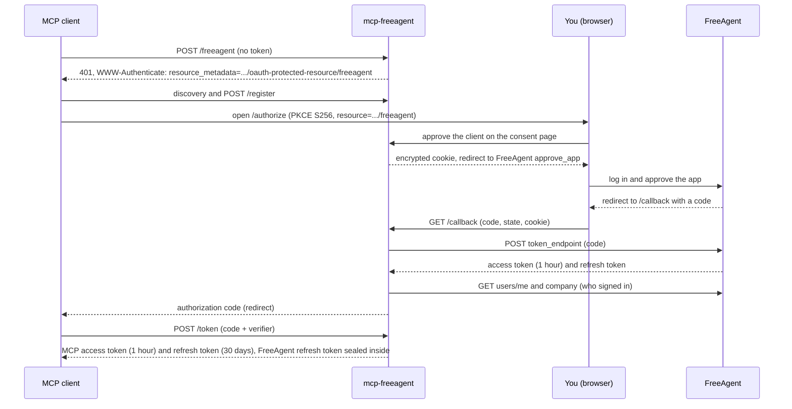

# Signing in with FreeAgent

There are no API keys and no shared password. Each person who connects a client signs in with their own FreeAgent login, and every tool call then acts as that FreeAgent user, within their access level.

## The FreeAgent app

The server reaches FreeAgent as one OAuth app, registered in the [FreeAgent Developer Dashboard](https://dev.freeagent.com/apps):

- `FREEAGENT_CLIENT_ID` is the app's **OAuth identifier** (8 to 128 letters, digits, `-` and `_`).
- `FREEAGENT_CLIENT_SECRET` is its **OAuth secret**. FreeAgent lets an app have two secrets at once, so a leaked secret can be replaced without downtime.
- Its redirect URI must be exactly `<PUBLIC_URL>/callback`, port included, for example `https://freeagent-mcp.example.com/callback` or `http://localhost:7771/callback`. Register one per address you run the server at.

The path `/callback` is reserved for FreeAgent's redirect.

`FREEAGENT_ENVIRONMENT=sandbox` points the server at FreeAgent's sandbox (`https://api.sandbox.freeagent.com/v2`) instead of the live API.

## A sign-in, step by step

1. **Consent.** `GET /authorize` shows which MCP client is asking (its self-reported name, marked unverified) and where you will be sent back to. The server asks here for every client, because all of them reach FreeAgent under this server's one app, so FreeAgent's own approval screen cannot tell them apart.
2. **To FreeAgent.** The button to continue to FreeAgent sets a cookie holding the pending request, encrypted under a key derived from `OAUTH_SIGNING_KEY` and bound to a random `state`. It is `HttpOnly`, `SameSite=Lax`, limited to `/callback`, `Secure` over https, and lasts 10 minutes. Your browser goes to FreeAgent's `approve_app` page.
3. **Back.** FreeAgent sends the browser to `<PUBLIC_URL>/callback`. The server checks `state` against the cookie, so FreeAgent's code is only accepted from the browser that started the sign-in, and exchanges the code at FreeAgent's `token_endpoint`.
4. **Who you are.** The server reads `users/me` and `company` to name you as `freeagent:<company subdomain>:user:<user id>` (or `freeagent:user:<user id>` when the subdomain is not available). That name is the subject in logs and the audit log, and stays the same across sign-ins.
5. **To the client.** The browser returns to the client with an authorization code, which the client exchanges at `/token` for its MCP tokens.

If you decline at FreeAgent, the client receives `access_denied`. If FreeAgent refuses the code, the page says why, and the attempt counts towards the [sign-in limits](security.md#sign-in-limits).

## Tokens

FreeAgent grants an access token (valid for an hour) and a refresh token. The refresh token is the person's credential:

- It is sealed into their MCP tokens with ChaCha20-Poly1305, under a key derived from `OAUTH_SIGNING_KEY`. Anyone holding an MCP token can read its claims, but not the sealed refresh token.
- On each tool call the server opens it and turns it into a FreeAgent access token. Access tokens are kept only in memory, per person, and refreshed 2 minutes before FreeAgent says they expire, one refresh at a time per person.
- If FreeAgent refuses an access token early, the server refreshes it once and sends the request again.

### Rotating refresh tokens and the token store

FreeAgent may hand out a new refresh token on each refresh, and does not say whether the old one keeps working. The server always uses the newest one. The sealed token inside the client's MCP tokens never changes, so the newest one has to be remembered elsewhere:

- **Without `FREEAGENT_TOKEN_STORE`**, it is remembered in memory only. A restart forgets it, and people whose refresh token was replaced must sign in again.
- **With `FREEAGENT_TOKEN_STORE`**, the newest refresh token of each sign-in is also written to that file, so restarts lose nothing.

The file is safe to keep on a volume:

- Each entry is encrypted with ChaCha20-Poly1305 under a key derived (HKDF-SHA256) from that sign-in's original refresh token, which only that person's MCP tokens carry, and is indexed by a hash of it. The file alone gives nothing away, even with `OAUTH_SIGNING_KEY`.
- It is created on the first write with mode 0600, together with its directory, and written atomically (a temporary file beside it, then a rename).
- Entries not updated for 100 days are dropped when the server starts. A sign-in that FreeAgent refuses is removed.
- A file that exists but cannot be read, or is not a token store, stops the server at startup. A failed write is logged (`writing the FreeAgent token store failed`) and counted in `freeagent_token_store_errors_total`; the tool call still succeeds.

Run one replica, or send each person to the same replica (sticky sessions), each with its own file. Two replicas sharing one file would overwrite each other's entries.

### Client authentication at FreeAgent

FreeAgent documents HTTP Basic authentication for the app's credentials, and the server uses it. If FreeAgent refuses them that way, the server tries once with them in the request body, keeps doing so if that works, and logs a warning naming the variables to check.

## Access levels

Tools can do only what the signed-in FreeAgent user can do. `get_current_user` reports their `permission_level`:

| Level | Access |
|---|---|
| 0 | None |
| 1 | Time |
| 2 | My money |
| 3 | Contacts and projects |
| 4 | Invoices, estimates and files |
| 5 | Bills |
| 6 | Banking |
| 7 | Tax, accounting and users |
| 8 | Full |

A call above the user's level fails with a `permission:` error that says so; see [Working with the tools](tools/overview.md#errors).

## What ends a sign-in

| Event | Effect | What the person does |
|---|---|---|
| The MCP access token is an hour old | 401 on the endpoint | Nothing: the client refreshes |
| The client has not refreshed for 30 days | Its refresh token has expired | Signs in again |
| 90 days since sign-in | Every grant lasts at most 90 days | Signs in again |
| FreeAgent no longer accepts the refresh token (revoked, expired, replaced and lost, or access to the app withdrawn) | Tools fail with `auth: FreeAgent no longer accepts this connection's sign-in ...` | Reconnects the connector, or runs `/mcp` in Claude Code |
| `FREEAGENT_ENVIRONMENT`, `FREEAGENT_API_URL` or `FREEAGENT_CLIENT_ID` changes | Every grant ends | Signs in again |
| `OAUTH_SIGNING_KEY` or `PUBLIC_URL` changes | Every token and client registration stops working | Removes the connector and adds it again |

Changing `FREEAGENT_CLIENT_SECRET` ends nothing. Restarts end nothing either, as long as `FREEAGENT_TOKEN_STORE` keeps any replaced refresh tokens.

The OAuth server itself is [mcp-server-core](https://github.com/Trozz/mcp-server-core-rs)'s, using its upstream sign-in; its documentation covers every token and endpoint in detail.

Next: [Connecting clients](connecting-clients.md).
